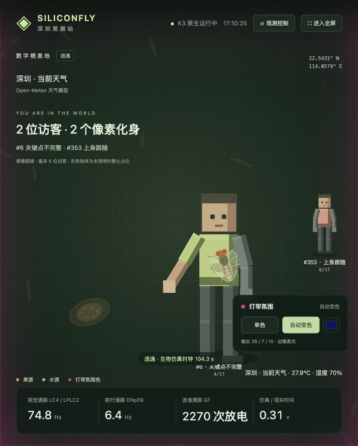

# 硅基果蝇 · 深圳观测站（K3 原生版）

🏆 **2026 进迭时空开发者大会二等奖作品**

本项目在 2026 年 10 月 17 日于深圳举办的进迭时空开发者大会（SpacemiT DevCon 2026）中获得二等奖。[大会介绍](https://forum.spacemit.com/t/topic/1692)

让一只由完整连接组驱动的数字果蝇，在 SpacemiT K3 上感知人体靠近、响应深圳天气与季节，并与像素人物和灯带氛围一起构成可交互的数字栖息地。

访问：`http://<K3-IP>:8330`（现场设备地址为 `http://192.168.5.23:8330`）。所有计算在 K3 上执行；Mac 只用于编辑、SSH 部署和浏览器查看，关闭 Mac 不影响 K3 服务。

K3 端运行：C++17/OpenMP 全连接组 LIF 神经仿真、Python 身体状态与生态参数、USB 摄像头采集、SpaceMIT YOLOv8n-Pose 人体与 17 关键点识别、WLED 串口控制、深圳天气获取、Gateway Qwen3 本地讲解。浏览器只绘制返回的状态与点云，不计算神经或身体行为。

## 现场演示

1. 打开页面，启动摄像头、连接灯带。实际灯数从 WLED 查询，本次设备为 30 灯。
2. 在摄像头前靠近，观察人体框扩张对应的视觉刺激。若拍摄角度不合适，点击“模拟靠近刺激”展示回路；按钮输入明确标记为人工输入。
3. 观察 LC4/LPLC2 放电上升、GF 放电与身体逃逸。灯带颜色由独立的单色/自动模式控制，不会被逃逸事件强制改色。
4. 勾选“钳制 GF 神经元”，等待原有逃逸动作结束，再施加相同刺激。视觉回路仍响应，GF 不再放电。取消钳制以恢复。
5. 切换“夜间”“冬季”“夏季”等人工气候场景，对照活动驱动；切回深圳当前天气。点“解读当前观测”，K3 本地模型结合遥测生成解释。
6. 页面默认场景铺满窗口；右上角“进入全屏”或 F 键请求浏览器原生全屏，C 键展开控制面板。浏览器原生全屏需要一次点击，嵌入式浏览器若限制此 API，可用独立浏览器打开同一网址。
7. 摄像头识别到的人以方块像素化身进入场景，镜像跟随手臂、腿部姿态。短期跟踪 ID 不代表身份；最多 6 人。可靠骨骼方向驱动方块肢体，缺失关节采用明确标记的灰色静止占位。让肩、肘、手腕进入画面更利于互动。
8. 右下角直接选择“单色”与“自动变色”；单色可以用色块选颜色。自动模式由 K3 每 24 秒循环色相，15 Hz 推送串口。页面约每 180 ms 读取相同的已发送 RGB，四周柔光随之变化。摄像头不再采样或参与环境颜色，也不再调制神经基础亮度。
9. 控制面板可分别调节灯带亮度（0–15%）与边缘氛围强度（8–42%）。画面采用有上限的普通 alpha 合成，不使用加法高光；中央不叠加灯光，人物与果蝇在光晕上方绘制。页面展示的是 K3 发给灯带的 RGB，不是光学实测色。灯带断开或状态过期时光晕消退。

## 数据与模型边界

- 完整加载原项目 FlyWire v783 数据：139,255 神经元、15,091,983 条聚合连接、54,492,922 个突触计数。启动构建时验证原文件 SHA-256。
- C++ 端每步代表 1 ms，固定点权重、4 ms 抑制延迟、种子噪声和原始回路映射来自 SiliconFly。累加器使用 int64 防溢出，4 个 CPU 线程更新神经元；不是 GPU/Metal 远程代理，也没有宣称神经仿真使用 NPU。
- 板端速度随负载变化，界面显示实际“仿真时间 / 现实时间”。当前还未达到完整生物时间实时运行；不会修改步长掩盖速度。
- 身体是程序化二维模型。前行、转向、梳理和逃逸取自神经输出，水源影响演示口渴状态；果源目前为场景装饰。这里没有复活生命、意识、真实果蝇动力学或生物学预测。
- 季节、温湿度、昼夜的系数为工程演示规则，未按实验数据拟合。灯带颜色仅驱动画面边缘氛围，不解释为果蝇情绪或真实果蝇光谱感知。
- 摄像头用检测框面积变化估计靠近，不测距离、不识别身份。光照/遮挡/多人目标切换可能产生误差；没有开展现场人体检测准确率基准。
- 相机图像只在 K3 内存与同一现场网络预览，应用不录制视频，不传到云模型。联网只用于天气。关闭摄像头释放设备。
- 天气来自 Open-Meteo 城市坐标天气模型，不是室内传感器或深圳气象局实测站。失效/过期时明确标记，采用中性驱动或可选人工实验场景，不伪造实时天气。
- 本地模型输出为自动讲解，可能有误；以旁边的原始参数与遥测为准。讲解期间暂停视觉模型，结束后恢复。

## 结构

`native/brain.cpp`：RISC-V C++ LIF 后端；`simulation.py`：板端进程与身体；`hardware.py`：摄像头与灯带；`climate.py`：天气与季节；`app.py`：板端 HTTP 与本地讲解；`web/`：无外部 CDN 的展示界面；`data/`：完整连接组；`tests/`：气候校验与真实后端对照实验。

运行命令见 [RUNBOOK.md](RUNBOOK.md)，验收记录见 [SUBMISSION.md](SUBMISSION.md)。原始用户项目保留在原目录；此项目不包含 Mac 应用运行入口。

## 从仓库部署

本仓库包含完整连接组数据（约 90 MiB），无需 Git LFS；模型权重、虚拟环境、现场日志和设备凭据不在仓库内。

在 K3 上将仓库克隆到 `~/k3-workshop/projects/siliconfly-shenzhen`，按照 [运行手册](RUNBOOK.md) 准备 RISC-V 依赖、构建神经后端并下载姿态模型。`board_setup.py` 保留了现场镜像的依赖路径，换板时需按实际环境调整；不能把它当作任意系统的一键安装脚本。

`deploy.py` 是现场电脑使用的可选 SSH 上传工具，依赖同级 `k3maker-skill/tools` 和本地 `device.json`，二者不随本仓库分发。直接在 K3 克隆和运行工程不需要该上传工具。请勿将设备密码或 `device.json` 提交到 Git。

## 来源

- SiliconFly 源码衍生实现，保留 [MIT License](LICENSE)。数据另见 [FlyWire 数据许可与引用](data/DATA_LICENSE.md)，CC BY-NC 4.0。
- [Open-Meteo API](https://open-meteo.com/en/docs)。深圳坐标 22.5431, 114.0579，时区 Asia/Shanghai。
- [深圳市气象局气候概况](https://weather.sz.gov.cn/qixiangfuwu/qihoufuwu/qihouguanceyupinggu/qihougaikuang/)：深圳夏季较长，不将十月自动等同气候学秋季。
- [SpacemiT 官方量化 YOLOv8n](https://archive.spacemit.com/spacemit-ai/model_zoo/vision/yolov8/yolov8n_no_dfl.q.onnx)，3,367,042 字节，官方响应 MD5 `434b4a1d6e9567c46d28030d47c17445`，下载后验证。

- [SpacemiT 官方 YOLOv8n-Pose](https://archive.spacemit.com/spacemit-ai/model_zoo/vision/yolov8_pose/yolov8n-pose.q.onnx)：3,797,711 字节，MD5 `29682aecea1d21c7191d7de1f1c3cc62`，在 K3 通过 SpaceMIT EP 推理。
